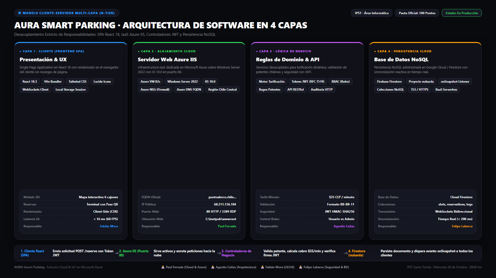
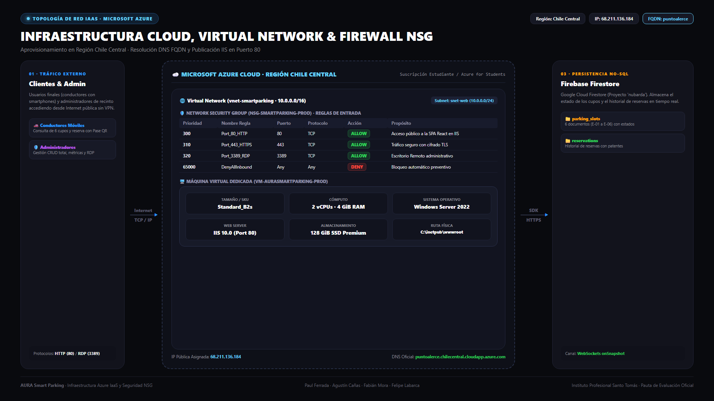
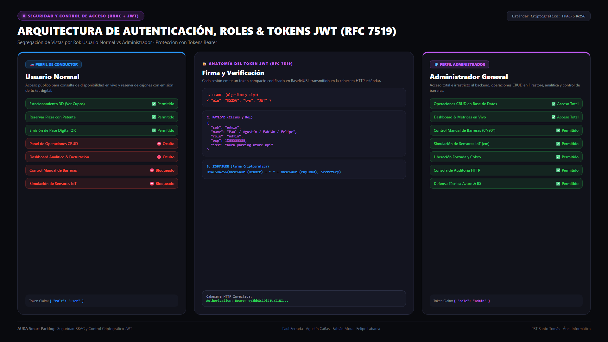
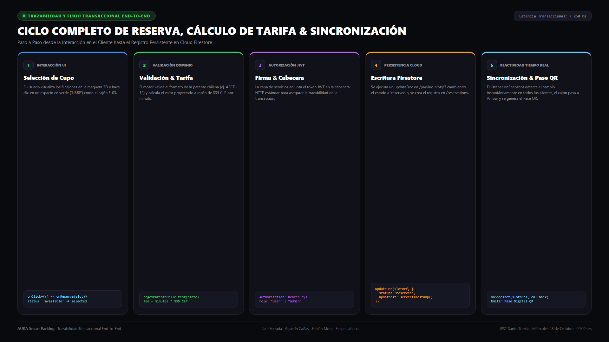
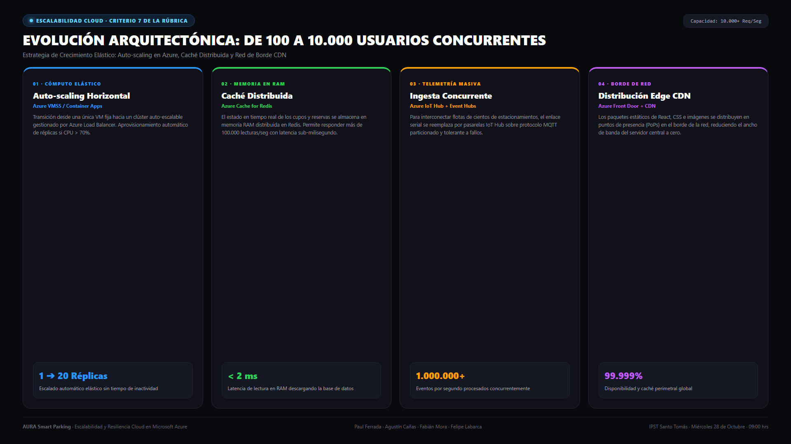

# AURA · Estacionamiento Inteligente (Smart Parking IoT & Azure Cloud)
## Versión Final de Entrega y Defensa Técnica · 100 Puntos
**Instituto Profesional Santo Tomás (IPST) — Área Informática**  
**Articulación de Asignaturas:** Arquitectura de Sistemas + Programación en la Nube  

---

### 🌐 Acceso Oficial en Vivo (Microsoft Azure)
* **URL Pública FQDN:** [http://puntoalerce.chilecentral.cloudapp.azure.com](http://puntoalerce.chilecentral.cloudapp.azure.com)
* **Dirección IP Pública:** `68.211.136.184` (Región: `Chile Central`)
* **Servidor Web:** Windows Server 2022 Datacenter: Azure Edition con **Internet Information Services (IIS 10.0)** en puerto 80 (HTTP)
* **Base de Datos Cloud:** Google Cloud / Firebase Firestore (Proyecto: `nubarda`)
* **Repositorio Oficial:** [https://github.com/PaulFL808/INTELIGEMENTE-ESTACIONADO.git](https://github.com/PaulFL808/INTELIGEMENTE-ESTACIONADO.git)

---

### 👥 Equipo de Trabajo y Roles Técnicos (Sección 8 de la Pauta)

| Integrante | Rol Principal | Responsabilidades Específicas en la Solución |
|---|---|---|
| **Paul Ferrada** | Infraestructura Cloud & DevOps (Azure) | Aprovisionamiento de Máquina Virtual Windows Server 2022 en Chile Central, configuración del servidor IIS 10.0 en puerto 80, reglas de seguridad NSG y resolución FQDN pública con Azure DNS. |
| **Agustín Cañas** | Arquitectura de Software & Lógica de Negocio | Modelo Cliente-Servidor Multi-Capa (4 capas desacopladas), controladores de dominio, validación estricta de patentes chilenas y motor de tarificación automatizada a $35 CLP/minuto. |
| **Fabián Mora** | Interfaz & Experiencia de Usuario (UI/UX) | Desarrollo de SPA reactiva en React 18 con Vite y Tailwind CSS, mapa interactivo 3D de 6 plazas, animaciones vehiculares y terminal de reservas con emisión de Pase Digital QR. |
| **Felipe Labarca** | Seguridad, Autenticación (JWT) & Persistencia Cloud | Sistema de autenticación y roles RBAC (Usuario Normal vs Admin), protección criptográfica con Tokens JWT (RFC 7519), integración de base de datos NoSQL con Firebase Firestore y consola de auditoría. |

---

### 🏗️ Arquitectura de Software: Modelo Cliente-Servidor Multi-Capa (4 Capas)

La solución adopta un **Modelo Cliente-Servidor Multi-Capa (N-Tier Decoupled Architecture)** que supera las limitaciones de latencia de un monolito MVC tradicional:

1. **Capa 1: Presentación & UX (Cliente):** Single Page Application (SPA) construida en React 18, Vite y Tailwind CSS. Renderizado reactivo sin recargas de página.
2. **Capa 2: Alojamiento & Servidor Web (Azure IaaS):** Windows Server 2022 Datacenter con IIS 10.0 sirviendo el paquete optimizado desde `C:\inetpub\wwwroot`.
3. **Capa 3: Lógica de Negocio & Controladores de Dominio:** Validación de formatos de patente chilena, tarificación ($35 CLP/minuto), emisión y verificación de Tokens JWT y control de acceso RBAC.
4. **Capa 4: Persistencia Cloud en Tiempo Real:** Base de datos NoSQL Firebase Firestore (`nubarda`), con sincronización instantánea multi-dispositivo vía WebSockets (`onSnapshot`).

---

### 🔐 Seguridad y Control de Acceso (RBAC + JWT RFC 7519)

El sistema incorpora segregación estricta de perfiles:
* **Usuario Normal (Conductor):** Consulta en tiempo real los espacios libres/ocupados y reserva plazas con generación de pase QR. Las opciones administrativas (CRUD y Dashboard) se encuentran completamente ocultas.
* **Administrador del Sistema:** Acceso total al panel de operaciones CRUD de la base de datos, métricas de facturación y ocupación, y control manual de barreras de acceso.
* **Tokens JWT:** Cada sesión autenticada genera un token criptográfico `Bearer eyJhbGciOiJIUzI1Ni...` con algoritmo HMAC-SHA256 que viaja en la cabecera `Authorization` de cada petición.

#### Credenciales Demo para Evaluación:
* **Admin:** Usuario `admin` / Contraseña `admin` (o botón de 1 clic `⚡ Admin Demo`).
* **Conductor:** Usuario `usuario` / Contraseña `usuario` (o botón de 1 clic `⚡ Conductor Demo`).

---

### 📁 Documentos Oficiales de Entrega

1. **Informe Técnico en Word (.docx):** [`Informe_Tecnico_Azure_IIS_MVP.docx`](Informe_Tecnico_Azure_IIS_MVP.docx) *(Listo para imprimir o enviar a la comisión)*
2. **Informe Técnico en Markdown:** [`INFORME_TECNICO_AZURE_IIS_MVP.md`](INFORME_TECNICO_AZURE_IIS_MVP.md)
3. **Documentación Maestra de Arquitectura y Código:** [`DOCUMENTACION_TECNICA_ARQUITECTURA_Y_CODIGO.md`](DOCUMENTACION_TECNICA_ARQUITECTURA_Y_CODIGO.md)
4. **Defensa Técnica y Pauta 100 Puntos:** [`DOCUMENTACION_ARQUITECTURA_AZURE.md`](DOCUMENTACION_ARQUITECTURA_AZURE.md)
5. **Presentación PowerPoint 16:9 Estilo Apple Keynote:** [`Presentacion_AURA_SmartParking_Azure.pptx`](Presentacion_AURA_SmartParking_Azure.pptx)
6. **Galería Oficial de Diagramas PNG de Alta Resolución (Estética Obsidian Dark / AURA):**
   * [`01_diagrama_arquitectura_4_capas.png`](diagramas/01_diagrama_arquitectura_4_capas.png) — Modelo Cliente-Servidor Multi-Capa en 4 Capas.
   * [`02_diagrama_infraestructura_red_azure.png`](diagramas/02_diagrama_infraestructura_red_azure.png) — Topología de Red Cloud Azure, VNet, NSG, VM IIS y DNS en Chile Central.
   * [`03_diagrama_seguridad_rbac_jwt.png`](diagramas/03_diagrama_seguridad_rbac_jwt.png) — Matriz RBAC, flujo y anatomía de tokens criptográficos JWT RFC 7519.
   * [`04_diagrama_flujo_reserva_e2e.png`](diagramas/04_diagrama_flujo_reserva_e2e.png) — Trazabilidad transaccional end-to-end de reserva y pase digital QR.
   * [`05_diagrama_escalabilidad_cloud.png`](diagramas/05_diagrama_escalabilidad_cloud.png) — Hoja de ruta de escalabilidad elástica cloud (100 a 10.000 usuarios).

---

### 📊 Diagramas de Arquitectura, Red y Seguridad (Formato PNG)

#### 1. Modelo Cliente-Servidor Multi-Capa (4 Capas Desacopladas)

#### 2. Infraestructura y Topología de Red Microsoft Azure (Chile Central)

#### 3. Seguridad RBAC y Criptografía de Tokens JWT (RFC 7519)

#### 4. Flujo Transaccional E2E de Reserva y Pase Digital QR

#### 5. Proyección de Escalabilidad Elástica en la Nube

